# Assignment 6 — jQuery Portfolio

**Name:** Saken Zhadiger  
**Group:** SE-2538

Учебное портфолио на HTML, CSS и jQuery. Страница демонстрирует селекторы, эффекты, изменение элементов и атрибутов, обработку ввода и анимацию полос навыков.

## Ссылки на проект

- **GitHub repository:** [bigstep832/assignment6](https://github.com/bigstep832/assignment6)
- **GitHub Pages:** [Открыть портфолио](https://bigstep832.github.io/assignment6/)

## Запуск и структура

Открой `index.html` в браузере. Сначала jQuery загружается с CDN. Если CDN недоступен, подключается локальная копия из `vendor`, поэтому функции работают и без интернета. Установка Node.js и сборка проекта не требуются.

```text
assignment6/
├── index.html
├── style.css
├── script.js
├── README.md
├── images/
│   ├── code.svg
│   └── music.svg
├── vendor/
│   └── jquery-3.7.1.min.js
└── screenshots/
```

- `index.html` задаёт содержимое страницы.
- `style.css` отвечает за оформление.
- `script.js` содержит обработчики кнопок и полей. Комментарии обозначают задания 0–8.
- `images` содержит две оригинальные учебные SVG-иллюстрации. Это демонстрационные изображения, а не личные фотографии автора.
- `screenshots` содержит снимки страницы для каждого задания.

Состояние страницы хранится только до перезагрузки: добавленные навыки, выбранная тема и введённые данные не сохраняются. Форма демонстрирует живой ввод; данные не отправляются на сервер.

## Part 1 — Getting Started with jQuery

### Task 0 — Setup

Полная версия jQuery 3.7.1 подключена через CDN перед `script.js`. Внутри `$(document).ready(function () { ... })` выполняется вывод `jQuery is ready!` в консоль браузера. Проверка: открыть инструменты разработчика, выбрать Console и обновить страницу.

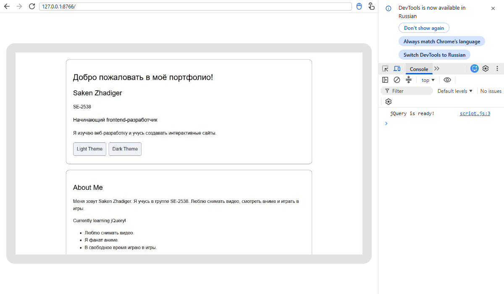

### Task 1 — Selectors and CSS

В профиле предусмотрены имя, личный заголовок и краткое представление. Селектор тега `$("h1")`, селектор ID `$("#greeting")` и селектор класса `$(".intro")` выбирают элементы. `.text()` меняет приветствие, `.css()` изменяет оформление. Кнопки Light Theme и Dark Theme меняют фон и цвет текста.

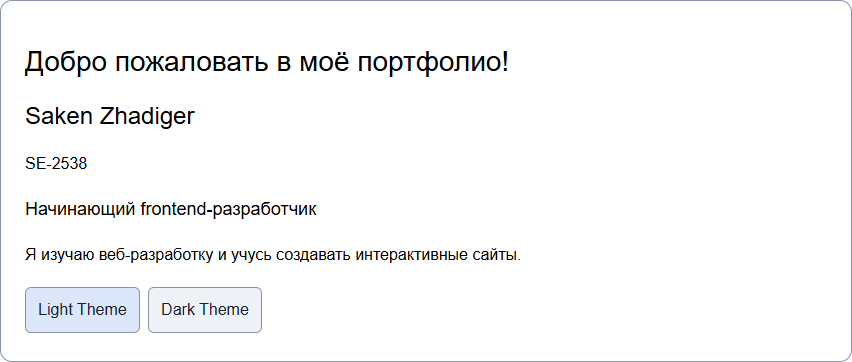

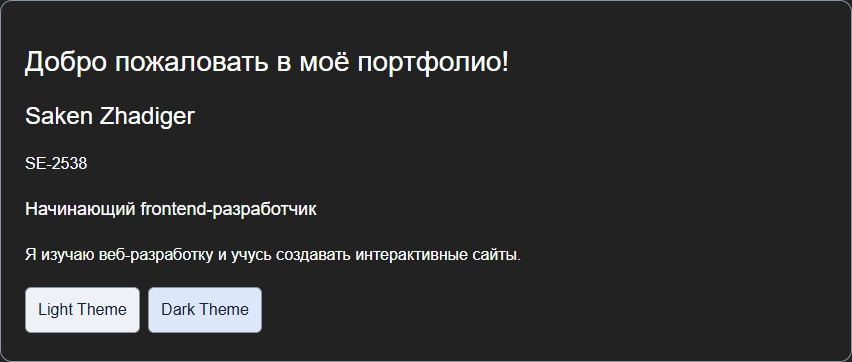

## Part 2 — jQuery Effects

### Task 2 — Visibility Methods

Раздел About Me содержит биографию, сообщение о текущем занятии и факты. Кнопки Hide, Show и Toggle управляют статусом с помощью `.hide()`, `.show()` и `.toggle()`.

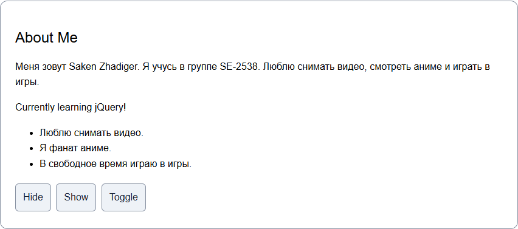

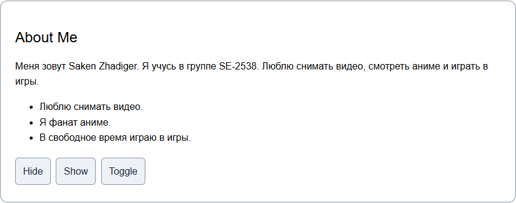

### Task 3 — Fade Methods

Галерея содержит два изображения. Кнопки Fade In, Fade Out и Fade Toggle используют `.fadeIn()`, `.fadeOut()` и `.fadeToggle()`. Для проверки появления сначала нужно скрыть изображения. Продолжительность эффекта задаётся в миллисекундах.

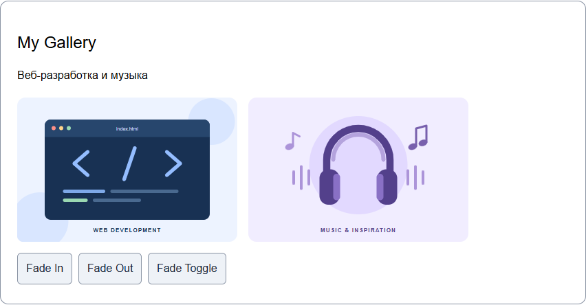

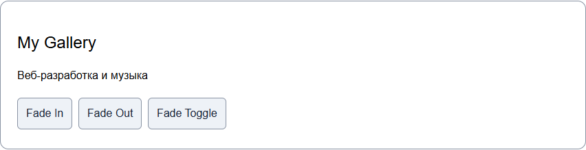

### Task 4 — Slide Methods

Три кликабельных заголовка открывают и закрывают собственные панели через `.slideToggle()`. Кнопка Open All раскрывает все панели методом `.slideDown()`, а Close All сворачивает их методом `.slideUp()`. При загрузке панели скрыты.

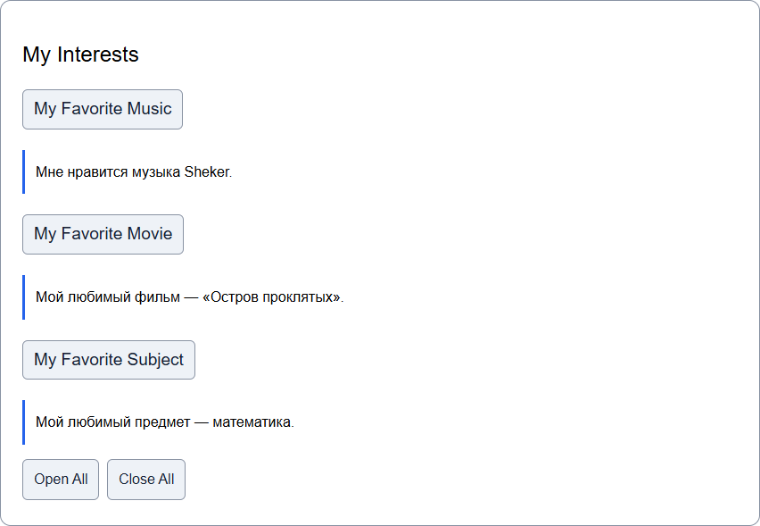

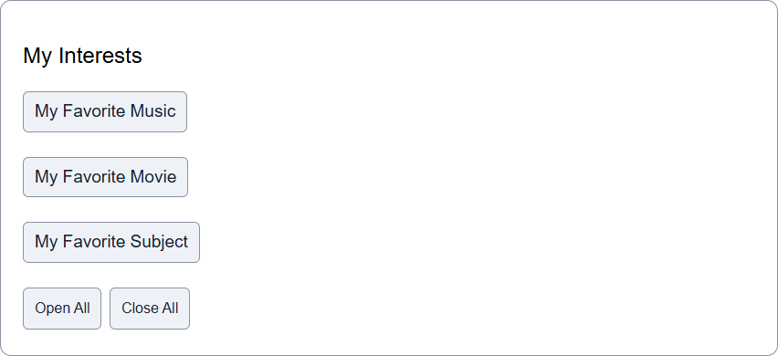

## Part 3 — DOM Manipulation with jQuery

### Task 5 — Add and Remove Elements

Начальный список содержит четыре технических навыка: HTML, CSS, JavaScript и Git. Add Skill добавляет введённый навык в конец через `.append()`, Prepend Skill — в начало через `.prepend()`. Remove Skill удаляет последний пункт через `.remove()`.

Значение поля читается с помощью `.val()`. После `.trim()` проверяется, что строка не пустая, поэтому пустое поле и строка из пробелов не создают пункт. Новый элемент создаётся через `$("<li>").text(skill)`: введённый текст не интерпретируется как HTML. После успешного добавления поле очищается.

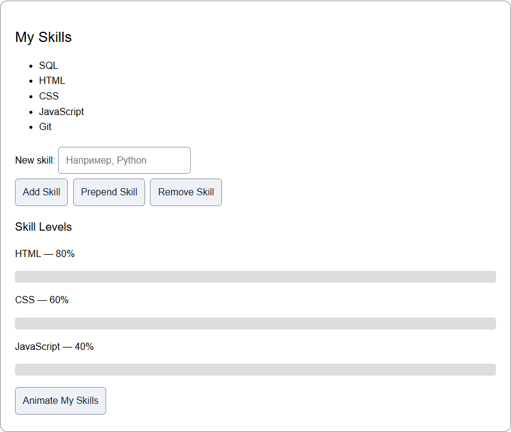

### Task 6 — Modifying Attributes

Кнопка Change Link меняет `href` ссылки методом `.attr()`: профиль `bigstep832` заменяется списком его репозиториев. Видимая подпись обновляется методом `.text()`.

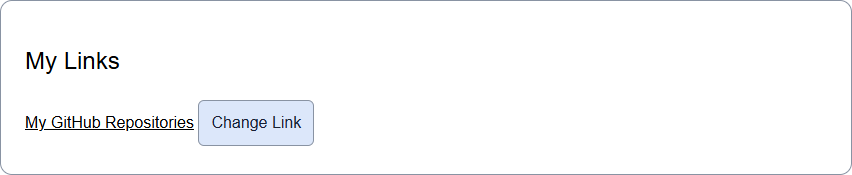

### Task 7 — Form Interaction

Форма содержит поля Name и Email. Обработчики события `input` читают значения через `.val()` и отображают их под формой через `.text()`. Изменения видны при печати, вставке и удалении текста. Отправка формы отменяется через `event.preventDefault()`, чтобы страница не перезагружалась.

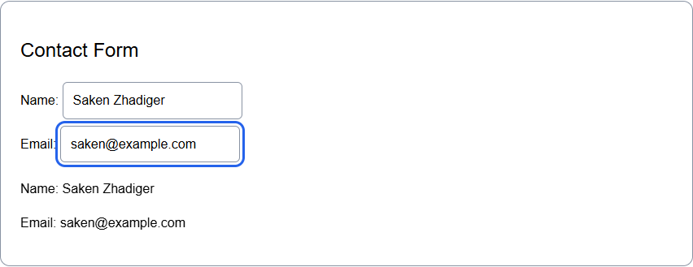

## Part 4 — Animations

### Task 8 — Basic Animation

Раздел навыков дополнен тремя полосами HTML, CSS и JavaScript. Изначально их ширина равна нулю. При первом нажатии Animate My Skills метод `.animate()` увеличивает ширину до разных значений: 80%, 60% и 40%. При повторном нажатии все полосы возвращаются к нулю.

Переменная `skillsVisible` хранит состояние, а обычный `if / else` выбирает направление анимации. Проценты показывают учебный пример и могут быть заменены собственными значениями.

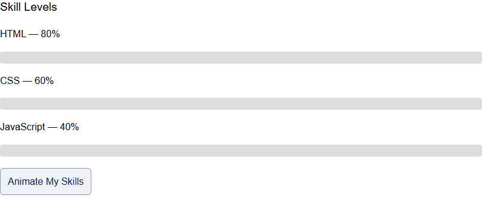

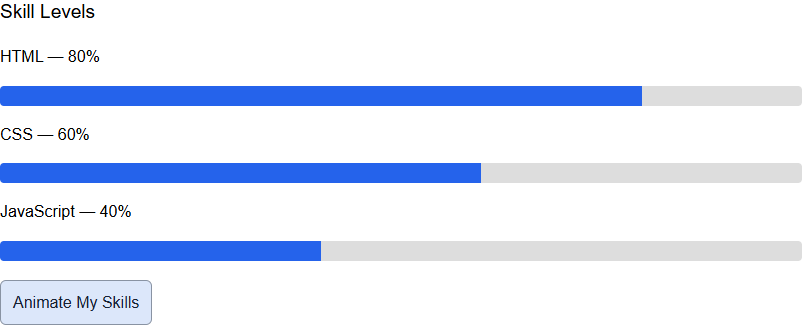

## Work Process Summary

Работа организована по заданиям. Сначала подготовлены HTML-разделы и подключена библиотека jQuery. Затем добавлены основные стили, селекторы и переключение темы. После этого реализованы эффекты, редактирование списка навыков, изменение ссылки и живое отображение формы. Последний функциональный этап — анимация трёх полос навыков. Для каждого задания предусмотрен отдельный раздел отчёта со скриншотами.

Во время проверки была обнаружена недоступность CDN в ограниченной сетевой среде. Добавлена локальная резервная копия jQuery: основным источником остался CDN. После этого проверены оба способа загрузки, все обработчики, пустой ввод, повторное нажатие анимации и отображение на узком экране. Для отчёта сохранены снимки реальных состояний страницы.

## Персонализация

- [x] Указать имя Saken Zhadiger и группу SE-2538 в README и на странице.
- [x] Добавить биографию, факты и интересы, сообщённые Saken: съёмка видео, аниме, игры, Sheker, «Остров проклятых» и математика.
- Учебные иллюстрации можно заменить собственными изображениями, обновив `src` и `alt`.
- [x] Указать подключённый GitHub `bigstep832` в HTML и JavaScript.
- При изменении процентов навыков нужно обновить и подписи HTML, и значения `.animate()`.
- [x] Сделать скриншоты страницы с именем, группой и интересами.
- [x] Добавить ссылки на репозиторий и GitHub Pages.

Используй относительные пути, например `images/code.svg` и `screenshots/task0.png`. Пути вида `C:\Users\...` не работают у других людей. Регистр букв в именах файлов должен совпадать с путями в коде.

## Публикация через GitHub Pages

1. Создать публичный репозиторий `assignment6` в своём аккаунте GitHub.
2. Загрузить все файлы и папки проекта. `index.html` должен находиться в корне репозитория, рядом с `style.css`, `script.js` и `README.md`.
3. Открыть **Settings → Pages**.
4. Выбрать **Deploy from a branch**, ветку **main** и папку **/(root)**, затем **Save**.
5. Дождаться завершения публикации и открыть **Visit site**.
6. Проверить на опубликованной странице изображения, кнопки и отсутствие ошибок в консоли.
7. Вписать ссылку репозитория и ссылку GitHub Pages в начало README.
8. Отправить в Moodle **обе ссылки**. Срок сдачи проверить в Moodle.

Изменения локальных файлов нужно повторно загрузить в репозиторий: открытие локального проекта само по себе не обновляет GitHub Pages.

## Подготовка к защите

Защита обязательна и составляет 50% общей оценки. Полезно уметь объяснить:

- порядок подключения jQuery и собственного скрипта;
- назначение `ready` и различия селекторов тега, ID и класса;
- работу `.on("click", ...)` и события `input`;
- отличия `.text()` от `.html()`, `.val()` от `.text()`;
- отличия скрытия элемента от `.remove()`;
- различие `.append()` и `.prepend()` и проверку пустого ввода;
- изменение `href` через `.attr()`;
- переключение `skillsVisible` и обе ветки `if / else` в анимации.
